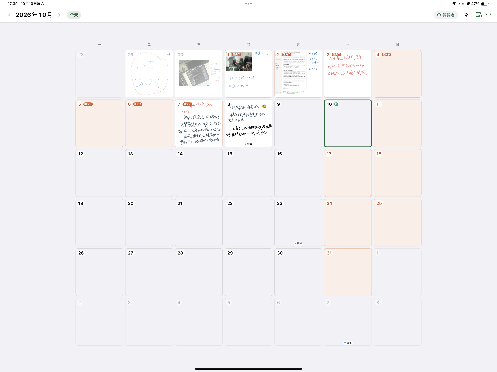
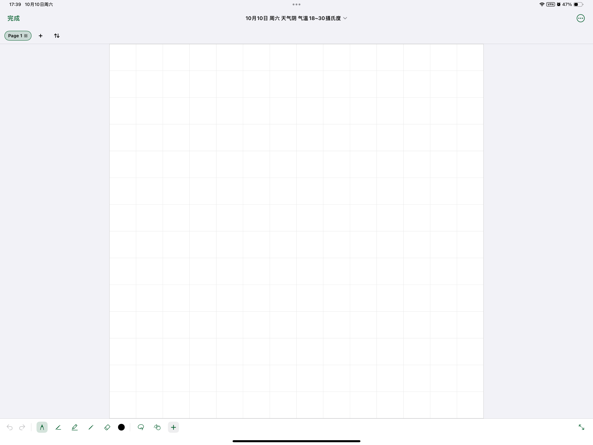
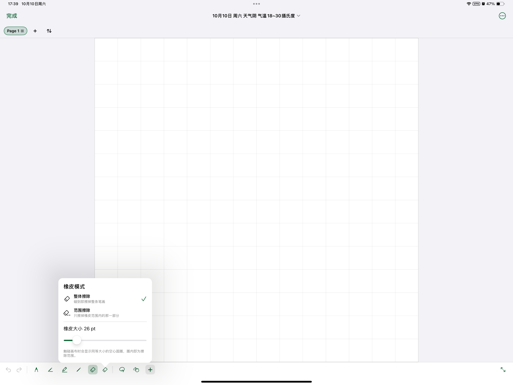
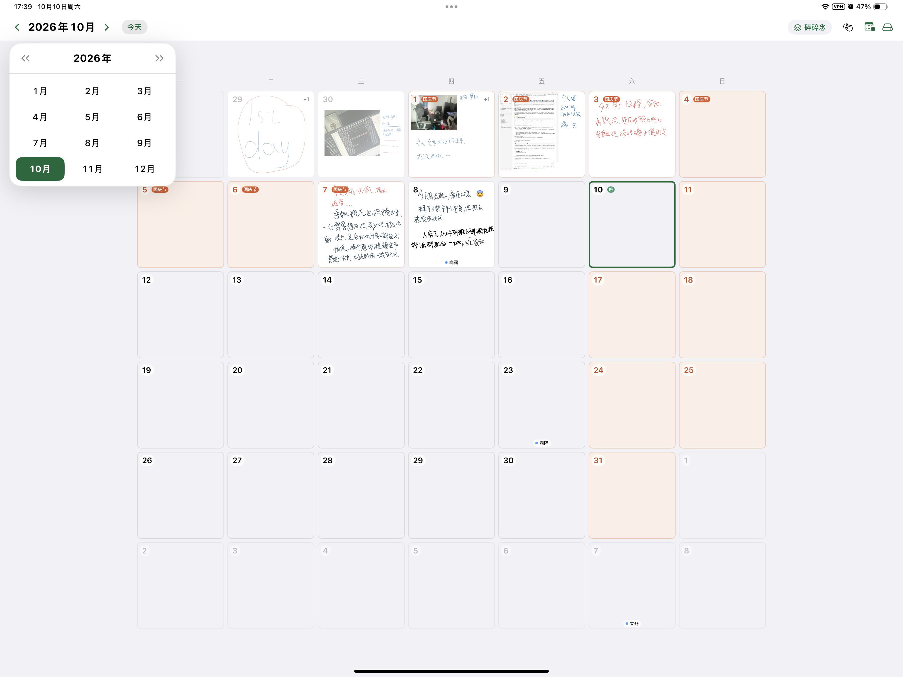
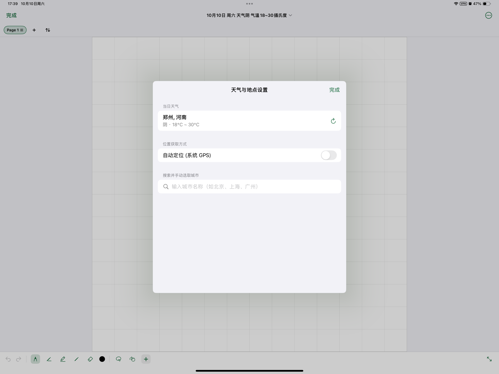
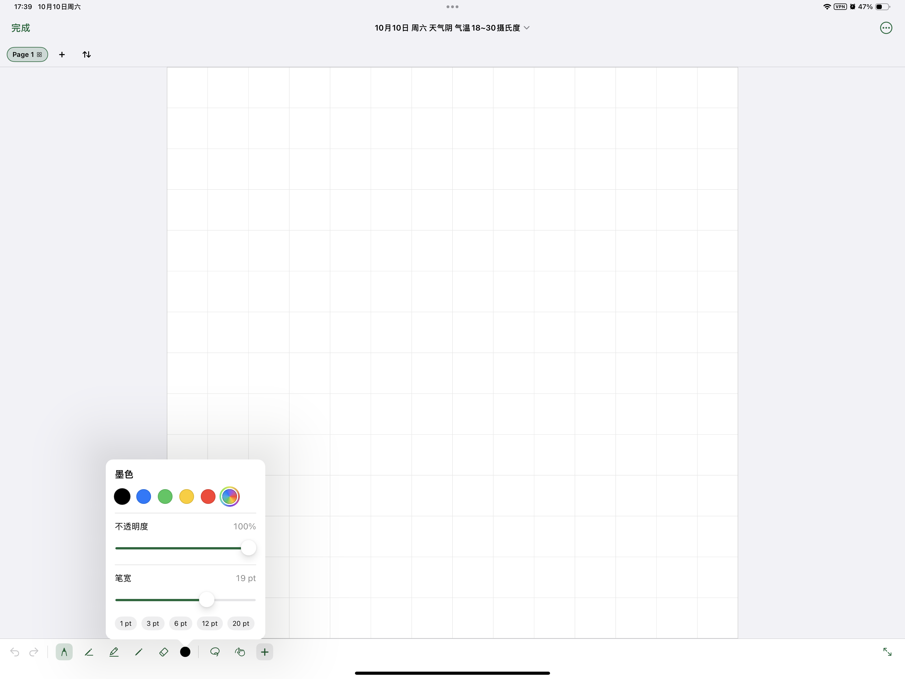
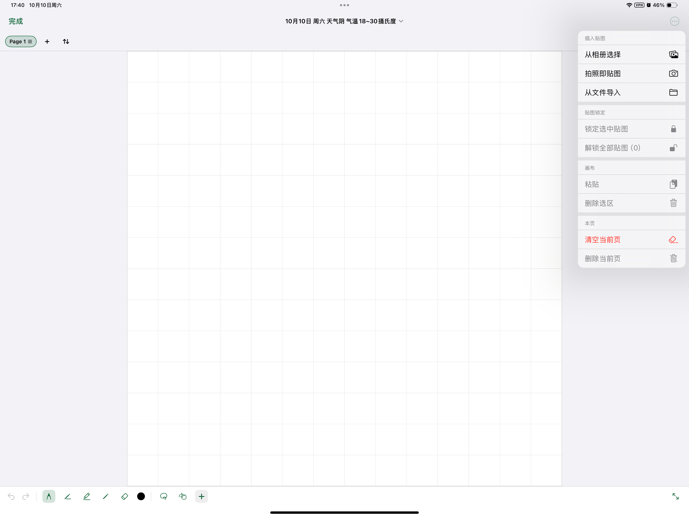
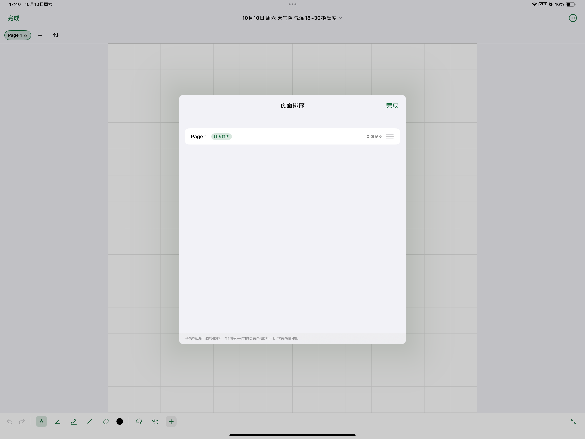
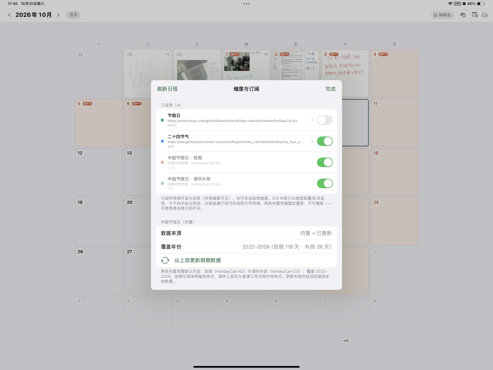
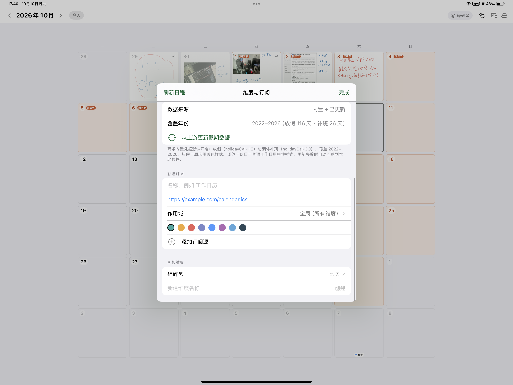

# 看见Calendar · SeeingCalendar

面向 **iPadOS 18+ / Apple Pencil** 的「视觉手绘日历」应用。
以 **无模板自由手绘** 为核心创作方式，以 **1:1 正方形网格缩略图联动** 为视觉载体，
实现「画即所得 · 日记即日程 · 月历即画廊」的闭环。

> **当前版本 `v1.0.37`** · iPad only（`UIDeviceFamily = [2]`）· Swift 6 严格并发 · 最低 iOS 18.0
> 构建走**本机 macOS 虚拟机**，交付物为未签名 `.ipa`（自行签名安装）。
> 工程严格按 `visual_calendar_product_tech_spec.md`（v2.2）落地，并由 `scripts/verify_*.swift` 的 10 项门禁守住既有行为约定。

---

## 1. 快速开始

**本仓库不使用 GitHub Actions**（仓库级 Actions 已关闭，`ios-build.yml` 处于 `disabled_manually`）。
构建在有 Xcode 的 Mac 上直接完成，**完整流程见 [`LOCAL-BUILD.md`](LOCAL-BUILD.md)**。

```bash
# 通用三步（任何装好 Xcode 的 Mac）
brew install xcodegen                       # 或按 LOCAL-BUILD.md §6 用 release zip 直装
xcodegen generate --spec project.yml
xcodebuild -project SeeingCalendar.xcodeproj -scheme SeeingCalendar \
  -configuration Release -sdk iphoneos -destination 'generic/platform=iOS' \
  CODE_SIGNING_ALLOWED=NO CODE_SIGNING_REQUIRED=NO CODE_SIGN_IDENTITY="" build
# 把 build/Build/Products/Release-iphoneos/SeeingCalendar.app 塞进 Payload/ 打成 zip，改名 .ipa
```

**本机（Windows + WSL2 + Docker-OSX）一条命令**：同步源码 → 10 项门禁 → 生成工程 → 编译 → 打包 → 拉回，
实测 60~70 秒（增量），产物落在 `artifacts/local-v<版本>/`：

```bash
wsl -d Ubuntu-24.04 -- bash /mnt/i/APP/livecontainer_dev/build-seeingcalendar.sh
```

拿到 `SeeingCalendar-unsigned.ipa` 后，用 AltStore / SideStore / Sideloadly / Xcode 自行签名安装到 iPad
（免费 Apple ID 亦可，7 天有效期）。

## 2. 工程结构

```
project.yml                      # XcodeGen 工程定义（.xcodeproj 是生成物，不入库）
LOCAL-BUILD.md                   # 本机编译全流程（环境、脚本、门禁、排障）
scripts/                         # 10 项行为门禁 + 工具脚本（图标生成 / vcal 布局校验 / 机械体检）
SeeingCalendar/
├── App/                 # 入口、SwiftData 数据栈、路径规划、日历计算与缓存
├── Models/              # SwiftData 模型 + 值类型（日历事件 / 班休状态 / 工具设置）
├── Store/               # 仓储层：元数据 ↔ 文件系统二进制；ZIP 归档；备份 / 恢复；天气；贴纸库
├── ICS/                 # RFC5545 子集解析器 + 订阅聚合索引
├── Canvas/              # ★ 复合画布：触控分流 / 统一套索 / 选区状态机 / 变换手柄 / 图元视图
├── Rendering/           # Page 1 缩略图确定性离线合成
├── Views/               # SwiftUI 外壳：月历 LOD 网格 / 编辑器 / 抽屉 / 订阅 / 备份 / 各工具面板
└── Resources/           # 资产目录 + 随包发行的中国节假日 ICS
```

## 3. 功能总览（v1.0.37）

### 3.1 月历与导航

* **恒定 1:1 矩阵**：7×6 固定网格，单元格边长 = `min(可用宽, 可用高)`，任何尺寸下都保持正方形；
* **三级 LOD**：LOD3（≥120pt 全量级）/ LOD2（≥70pt 紧凑级）/ LOD1（<70pt 极小级），
  ICS 日程随之降级为微胶囊 → 彩点 → 单微点，手绘始终占据 ≥85% 视觉焦点；
* **日期状态**：今天 / 选中环 / 周末暖色 / 非本月淡化（~0.4 不透明度）/ 班休标记；
* **进入画布**：单击选中 → 再次单击已选中日格直达全屏画布；也可直接双击；
* **翻月与定位**：左右翻月（带物理橡皮筋阻尼）、「今天」胶囊定位（非今天时淡化弱对比）；
* **月份选择面板**：年份可滑动切换，年份头部与月份网格上带**现实时间锚点**指示（当年当月）；
* **缩略图**：Page 1 作为该日封面，异步合成 + 并发合并 + 非破坏提交，翻回来不丢图。

### 3.2 单日画布与绘图

* **严格 1:1 画纸**（1400×1400，恒定世界坐标系），**无限多页**，Page 1 唯一定位为封面；
* **四种笔 + 橡皮**：钢笔 / 自动铅笔（等宽 mono-line，适合表格勾线）/ 马克笔 / 铅笔，各自**独立记忆笔色、笔宽与不透明度**（10%~100%），切笔瞬时恢复；橡皮有独立尺寸档位与模式；
* **调色盘**：5 个高频预设色（黑 / 蓝 / 绿 / 黄 / 红）+ 系统全色域拾色器（看齐 iOS 备忘录）；
* **纸张底色**：纯白 / 复古和纸（护眼米白）/ 暖调羊皮 / 护眼豆绿，偏好持久化；
* **触控分流**：模式 A（Pencil 独占，手指单指平移）/ 模式 B（全触控书写）；
* **手势**：双指轻点撤销、三指轻点重做、Apple Pencil 硬件双击（切笔 ↔ 橡皮 / 唤起调色盘）、
  画布左右留白区**边缘双击快速切换工具**（左右独立配置「上一工具 / 指定工具」，严格过滤手指触摸，仅画纸外围生效）；
* **多页管理**：底部页面胶囊条（`matchedGeometryEffect` 平滑滑动）、排序抽屉、下拉返回手势（区域化门控，画纸内不触发）。

### 3.3 手帐与批注工具（看齐 iOS 备忘录）

| 工具 | 能力 |
|---|---|
| **文本** | 多行输入、字体风格（标准/衬线/圆角/等宽）、字号 16~72pt、颜色、便签底色（透明/黄便签/白卡/深色卡） |
| **贴纸** | 内置效率徽章（TODO / DONE / 重点 / 目标 / 打卡 / 会议 / 生日 / 纪念…）+ 系统 Emoji 全库（10 大分类，矢量渲染） |
| **签名** | 高拟真手写签名板、黑/蓝/红墨水、自动透明留白裁剪、可保存复用 |
| **形状** | 9 种图元（圆角矩形 / 矩形 / 圆 / 五角星 / 对话框 / 箭头 / 爱心 / 三角 / 直线），线宽、描边色、填充模式（无/半透明/纯色）与整体透明度 |

* 所有图元统一接入复合画布：缩放 / 旋转 / 平移 / 层级置顶置底 / 锁定 / 全局撤销重做；
* **文本与形状支持二次编辑**：点选后悬浮菜单出现「编辑」，原地无损更新并保持中心锚点，属性预填；
  元数据走轻量 `.meta` 文件 + SwiftData `payloadJSON` 双轨互备，跨启动、复制粘贴全生命周期安全。

### 3.4 贴纸系统

* **多源导入**：相册透明贴图、系统贴纸键盘、剪贴板贴纸一键存入；
* **画布图元存为贴纸**：选中文本 / 形状 / 图片即可「存贴纸」，完整保留尺寸、无损裁剪视窗与旋转角度；
* **特征指纹去重**：改尺寸 / 重裁剪 / 改旋转 / 改文字后再存，会自动作为新贴纸加入；无变化不产生冗余副本；
* 支持正序 / 逆序排序偏好持久化、编辑管理模式与长按删除。

### 3.5 图片与自由变换

* 导入方式：相册 / 拍照 / 文件，入场按 1:1 居中或 Aspect Fit 90% 安全区智能缩放；
* **无损裁剪**：只改 `contentsRect`，配合 `M_new = T(natural·Δorigin) ∘ M_old` 保持画面静止；
* 单张贴图：4 角等比缩放 / 4 边裁剪 / 顶部旋转（1° 步进 + 15°/45°/90° 吸附与触觉反馈）；
* 操作：拷贝 / 替换 / 置顶 / 置底 / 锁定 / 删除；锁定的贴图显示角标并从命中判定中完全让位（手绘可从其上方直接落笔）。

### 3.6 撤销 / 重做与历史

* **30 步统一快照**：笔迹与所有图元（贴图 / 文本 / 形状 / 签名 / 贴纸）状态一并入栈，撤销粒度跨图层一致；
* **单一引擎**：在复合画布容器（`CompositeCanvasContainerView.swift`）内，整份赋值**只允许 1 处** —— 换页装载 `installDrawing`；
  页内写入（撤销 / 重做 / 选区提交 / 套索取出）一律只替换笔迹列表（`canvasView.drawing.strokes = ...`），绝不整份替换 `PKDrawing`：
  它带 CRDT 版本谱系（`uuid` / `replicaUUID` / `version`），整份赋值等于把**旧版本**交给画布，
  被撤销的笔画会在笔离开画布时按版本对账「复活」（时机正是笔离开画布那一刻）；
  *工具面板（如签名板）用的是各自独立的 `PKCanvasView`，其清空赋值与主画布的历史无关。*
* 任何内容变更都会让重做栈失效；撤销 / 重做后立即落盘（不等 2 秒防抖）。

### 3.7 日程订阅与节假日

* **ICS 订阅**：RFC5545 子集解析，支持 `DAILY` / `WEEKLY(+BYDAY)` / `MONTHLY` / `YEARLY` 与 `INTERVAL/COUNT/UNTIL/EXDATE`；
  复杂规则（如 `BYSETPOS`）退化为首次发生，不做过度工程；
* 订阅管理：新增 / 编辑（地址可改，变更后自动全量拉取）/ 刷新（原地刷新全部网络源 + 合并节假日上游），列表展示更新时刻；
* **多选作用域**：每条订阅可绑定多个画板维度（空 = 全局；「全局」行与维度行互斥），筛选同时作用于月历与抽屉；
* **中国节假日**：两条随包发行的内置凭据 —— `holidayCal-HO`（放假，116 条，覆盖 **2022-12-31 跨年元旦起至 2026**）与
  `holidayCal-CO`（调休补班，26 条，覆盖 **2023–2026**）；默认开启、固定置底且不可删除（不用请关开关），冷启动零网络即可正确着色；
  班休样式与周末暖色统一走 `DayCellAppearance` 集中管理，且适配深色模式。

### 3.8 维度（工作区）

* 工作 / 生活 / 个人创作等多维度隔离，可在月历页与右侧抽屉间切换；
* 维度与订阅的管理界面统一收敛为「维度与订阅」，列表顺序为**稳定分区**（自定义在前、内置置底），
  ForEach 与删除偏移共用同一个出口，绝不会删错行。

### 3.9 当日天气

* 数据源 **Open-Meteo**（免密钥）；支持 CoreLocation 自动定位与城市检索（Geocoding），带离线缓存与定时刷新；
* 呈现：画布页顶栏的天气胶囊（SF Symbol 动态图标 + 温度区间），点按展开卡片式天气与地点管理面板。

### 3.10 备份与归档

* **`.vcal` 容器** = ZIP：`manifest.json` + `database_dump.json` + `drawings/*.drawing` + `assets/*`（+ 图元 `.meta`）；
* **写入**：STORE 模式流式落盘（素材本身已是压缩码流，避免二次压缩的 CPU/内存开销），常驻内存恒定一个 chunk；
* **读取**：以中央目录为唯一索引，兼容 STORE / Deflate（含数据描述符），逐条 CRC32 校验 + 清单指纹比对；
* **恢复**：**完整覆写** 与 **智能增量合并**（同日冲突时把备份画页转为后置拓展页，绝不覆盖现有笔迹）；
* **定时快照**：本地保留 3 份，可一键回滚；
* 开启 iOS 文件共享与「用其他应用打开」，`.vcal` 已注册 UTI（`com.seeingcalendar.vcal`）。

### 3.11 视觉与性能

* **Apple HIG 视觉系统**：`systemGroupedBackground` 分层底色、自适应微描边 + 超低不透明度环境阴影、
  8pt 栅格节奏、12~18pt `.continuous` 连续圆角；信息架构做渐进式呈现（次要设置收进更多菜单）；
* **120Hz 帧预算优化**：`Calendar` / `holidayCalendar` 持久化缓存（时区变更自动失效）、
  月历拖拽期 `.compositingGroup()` 折叠为 3 张 GPU 纹理、`MonthGridView.==` 等值短路（选中环拆到 `equatable()` 之外）、
  广播式动画作用域隔离、手势过程零 `@State` 脏写；
* **物理动效**：统一弹簧曲线（`.spring(response: 0.24, dampingFraction: 0.80~0.84)`），
  选中框滑行弹簧、多页胶囊 `matchedGeometryEffect`、选区菜单自锚点立体微缩放弹出；
* **系统适配**：Split View / Slide Over / 台前调度下自动切单列流式布局，
  并用**窗口场景方向**（而非视图尺寸）判断横竖屏，避免键盘压缩高度导致布局翻转。

## 4. 核心架构要点

### 4.1 五层复合画布与触控仲裁（spec 3.1）

```
Layer 5  SelectionOverlayView        虚线框 / 8 向手柄 / 旋转锚点 / 原生菜单 / 套索捕获
Layer 4  SelectionContentContainer   浮动选区（被取出的笔迹位图预览）
Layer 3  ImageFrontContainerView     置于「笔迹之上」的贴图（置顶后进入）
Layer 2  PKCanvasView                透明矢量手绘层（drawingPolicy 受「手指书写」开关控制）
Layer 1  ImageLayerContainerView     笔迹之下的自由变换贴图（无损裁剪：只改 contentsRect）
Layer 0  PaperBackgroundView         恒定 1400×1400 正方底纸 + 网格参考线
```

`zIndex` 用一个整型同时编码层内序号与前后层归属（`zIndex >= 10000` 即位于笔迹之上），
「置顶 / 置底」因此能真正跨越手绘层，而无需引入 schema 变更。

`CompositeCanvasContainerView.hitTest(_:with:)` 在事件分发的第一纳秒做三件事：

1. 选区覆盖层（手柄 / 菜单 / 套索）优先命中；
2. 逆序判定落点是否落在任一贴图的多边形外框内 —— **命中即返回贴图视图**，`PKCanvasView` 完全收不到这次 `touchesBegan`，
   从底座杜绝「手指绘制开启时在照片上留下污点」；
3. 空白区域才转交 PencilKit。

> 触控**类型**（手指 / Pencil）在 `touchesBegan` 里判定后记录，绝不在 `hitTest` 里查 `UIEvent.allTouches`——
> UIKit 调用 `hitTest` 早于 `touchesBegan`，那时新触点往往还不在集合里。

### 4.2 跨图层统一套索（spec 3.2）

* 自绘套索（不依赖 `PKLassoTool` 的私有选区），闭合后交给 `UnifiedLassoArbitrator`：
  AABB 粗筛 → 笔迹采样点射线法细筛 → 贴图**真多边形**判定（互为包含或任意边相交，擦边即选中）；
* 命中笔迹会**从画布中取出**成为「浮动选区」，变换时只改预览视图的 `transform`（视觉预览零成本），
  手势结束才把 delta 烧进 B 样条控制点并同步缩放线宽——几何统一在同一个世界坐标系里；
* 选区含笔迹时默认进入**组变换**（纯单图路由到图片编辑、纯多图路由到合成），复合选区支持 8 向整体缩放与旋转。

### 4.3 1:1 矩阵与动态 LOD（spec 1.2 / 3.5）

见 §3.1。核心是「单元格边长由可用空间推导」而非固定值，因此任意分屏比例下都是正方形；
LOD 切换依据**实际渲染宽度**，而非设备型号。

### 4.4 `.vcal` 归档闭环（spec 3.4）

见 §3.10。侵入性最小的设计是**只存元数据指针与二进制分档**：SQLite/SwiftData 只管索引，
画页与素材各自成为独立文件，于是备份 = 打包目录 + dump 一份索引，恢复 = 反向还原。

### 4.5 Swift 6 严格并发

全部 UI / SwiftData / PencilKit 状态锚定 `@MainActor`；网络解析与缩略图合成走 `Task.detached` + Sendable 值类型；
备份打包为独立 `actor`；跨隔离域一律降维为纯值 DTO（`SubscriptionSnapshot` / `ThumbnailImageSpec` / `RestoreBundle`）。
工程开启 `SWIFT_STRICT_CONCURRENCY = complete`。

## 5. 质量保障：10 项门禁

`LOCAL-BUILD.md` §7 有完整清单。它们把「已在真机上验证过的行为约定」钉死在源码里 ——
例如「撤销的笔画不会复活」被钉成「复合画布容器内整份赋值只允许 1 处、页内必须走 `strokes`」这样的源码级断言，
并用穷举 37448 条撤销序列做反证；「订阅内置置底」被钉成「ForEach 与删除偏移共用同一个出口」。

门禁自身也有门禁：`scripts/gate_preflight.py` 会先检查每条断言「接收变量是否在作用域内」「字面量是否真能在目标文件里找到」，
一行笔误就会让整条流水线作废，所以它在最前面拦住。

## 6. 已知取舍（显式决策，而非疏漏）

1. **画布缩放**：全图层共用同一世界坐标系的外层 `UIScrollView`，保证套索 / 贴图 / 笔迹几何永不错位。
   笔迹为 PencilKit 1:1 渲染，放大超过 100% 时由 GPU 采样纹理，属正常位图放大表现；
   若要原生级锐度，需改用 `PKCanvasView` 自带 zoom + 逐帧同步贴图层变换（复杂度显著上升）。
2. **`.vcal` 写入不压缩**：素材本身已是压缩格式，二次压缩收益 <5% 却带来 CPU 与内存成本；读取侧完整支持外部工具产生的 Deflate 归档。
3. **归档单档 <4GB**：未实现 ZIP64，遇到超大素材库会给出明确错误而不是静默损坏。
4. **ICS 规则覆盖**：复杂递归（如 `BYSETPOS`）退化为首次发生。
5. **未签名 IPA**：构建时显式 `CODE_SIGNING_ALLOWED=NO`，交付物需自行签名安装。
6. **极小格触控**：1/3 分屏下 LOD1 单格约 45pt，目前依靠整格 `contentShape` 热区 + 直达画布；
   spec 4.3 建议的气泡放大镜未实现，避免引入额外预览合成开销。
7. **订阅作用域**：**空作用域 = 全局**。这个约定让老库升级、旧备份恢复、维度被删除时摘空引用三件事同时变简单；
   代价是「一个维度都不选」与「全局」在模型上是同一状态 —— 靠界面上「全局」行是否亮起表达，不靠文案解释。
8. **锁定是整页解锁**：锁定的图元从命中判定中完全让位（手绘可穿透其上），解锁按整页进行，避免出现「点不到的死锁对象」。

## 7. 验收边界

| 环节 | 手段 | 状态 |
|---|---|---|
| 编译 / 链接 / 打包 | 本机 macOS（Xcode 26.6 / iOS SDK 26.5）+ `xcodebuild` Release | ✅ 0 error |
| 10 项行为门禁 | 6 个 `verify_*.swift --strict` + 2 个语义探针（swift）+ `swift_lint.py` / `gate_preflight.py` | ✅ 全过（断言量见 [LOCAL-BUILD.md](LOCAL-BUILD.md) §7） |
| 产物结构 | 解包 IPA 校验 Bundle ID / UTI / 方向 / 权限文案 / 内置 ICS | ✅ 通过 |
| `.vcal` 容器格式 | `scripts/verify_vcal_layout.py` 按 Swift 写入布局重建 → 标准 ZIP 读取器解析 | ✅ 通过 |
| 手势延迟 / PencilKit 手感 / SwiftData 持久化 | **需真机** | ⚠️ 待上 iPad 验收 |

## 8. 界面截图

`UI_screenshot/` 下是按时间顺序的实机截图（`IMG_1209` ~ `IMG_1218`）：

| | |
|---|---|
|  |  |
|  |  |
|  |  |
|  |  |
|  |  |
